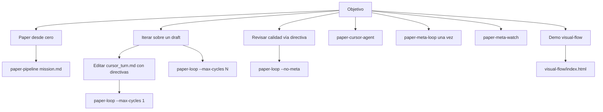

# Paper pipeline

Pipeline orientado a **borrador de paper asistido por LLM**: un único `mission.md` define el tema y las secciones; el orquestador llama a Perplexity (vía [perplexity-webui-scraper](../perplexity-webui-scraper)), **Mistral** (`provider: mistral`, sin búsqueda web en vivo) o MiMo (`provider: xiaomi_mimo`), genera `outputs/`, un borrador consolidado, calidad opcional (revisión asistida, no validación empírica independiente) y Notion si lo activás. **No** sustituye experimentos ejecutados ni replicación científica sin pasos adicionales — ver [docs/MODE_NARRATIVE_VS_EMPIRICAL.md](docs/MODE_NARRATIVE_VS_EMPIRICAL.md) y [docs/ARXIV_TARGET_ALIGNMENT.md](docs/ARXIV_TARGET_ALIGNMENT.md). Benchmark: [scripts/benchmark_provider_comparison.py](scripts/benchmark_provider_comparison.py). Misión repo-adoption: [data/missions/repo-adoption-mistral/mission.md](data/missions/repo-adoption-mistral/mission.md). Por defecto cada sección Perplexity usa una **conversación nueva**; `single_thread_perplexity: true` reutiliza un hilo. `save_perplexity_to_library: true` (default) hace visibles los hilos en la biblioteca web.

**Índice de toda la documentación** (guías, técnica, pruebas): [docs/README.md](docs/README.md).

**Inventario técnico** (todos los comandos `paper-*`, extras pip, variables sueltas): [docs/technical/07-inventario-cli-y-entorno.md](docs/technical/07-inventario-cli-y-entorno.md).

**Estado del proyecto, limitaciones, qué está probado y objetivo final:** [docs/ESTADO_Y_OBJETIVO.md](docs/ESTADO_Y_OBJETIVO.md).

**Flujo paso a paso, bucles, “volver atrás”, integración y Cursor CLI:** [docs/GUIA_FLUJO_COMPLETO.md](docs/GUIA_FLUJO_COMPLETO.md).

**Archivos en `outputs/` (quién escribe qué, cuándo existe cada uno):** [docs/OUTPUTS_REFERENCE.md](docs/OUTPUTS_REFERENCE.md).

**Pruebas por componente, entradas/salidas y flujos completos (CLI, API, debug):** [docs/GUIA_PRUEBAS_Y_DEBUG.md](docs/GUIA_PRUEBAS_Y_DEBUG.md).

**Hipervisor de triaje (tiers), `metrics.json`, CLI `paper-parallel`, worktrees:** [docs/HIPERVISOR_Y_PARALELO.md](docs/HIPERVISOR_Y_PARALELO.md).

**Desarrollo y contribución (código, tests, convenciones, `web/`):** [docs/DESARROLLO_Y_CONTRIBUCION.md](docs/DESARROLLO_Y_CONTRIBUCION.md).

## Requisitos

- Python 3.10+
- Cuenta Perplexity Pro/Max y `PERPLEXITY_SESSION_TOKEN` (cookie de sesión).
- (Opcional) Integración Notion: token de integración interna y `notion_page_id`.

## Instalación

Orden recomendado: **1)** dependencia [perplexity-webui-scraper](../perplexity-webui-scraper/README.md) — instalación con `uv`/PyPI o editable, extras (`cli`, `mcp`, `api`), obtención del token — **2)** este paquete (`paper-pipeline`).

### Entorno virtual (venv) — recomendado para desarrollo

Crea un venv en la carpeta `paper-pipeline` para aislar dependencias. La carpeta `.venv/` está en `.gitignore`.

**Windows (PowerShell):**

```powershell
cd paper-pipeline
python -m venv .venv
.\.venv\Scripts\Activate.ps1
pip install -e ..\perplexity-webui-scraper
pip install -e ".[dev,e2e]"
python -m playwright install chromium
```

**Linux / macOS (bash):**

```bash
cd paper-pipeline
python3 -m venv .venv
source .venv/bin/activate
pip install -e ../perplexity-webui-scraper
pip install -e ".[dev,e2e]"
python -m playwright install chromium
```

Con el venv activado, los comandos `paper-pipeline`, `pytest`, etc. usan ese intérprete.

**Instalación editable mínima (sin venv):** desde el directorio padre que contiene ambos repos:

```bash
cd perplexity-webui-scraper
pip install -e .

cd ../paper-pipeline
pip install -e .
```

### Docker

Hay un [`Dockerfile`](Dockerfile) orientado a **construir desde la raíz del monorepo** (donde conviven `perplexity-webui-scraper/` y `paper-pipeline/`). Copia el scraper, instala `paper-pipeline[dev]` y por defecto ejecuta **tests** (`pytest` excluyendo integración), no un servidor de producción.

**Construir la imagen** (desde la carpeta padre de ambos proyectos):

```bash
docker build -f paper-pipeline/Dockerfile -t paper-pipeline .
```

**Ejecutar el CLI del pipeline** con token en el entorno y un `mission.md` montado (no guardes el token en la imagen):

```bash
# Linux / macOS
docker run --rm \
  -e PERPLEXITY_SESSION_TOKEN \
  -v "$(pwd)/mission.md:/app/mission.md" \
  paper-pipeline paper-pipeline mission.md
```

```powershell
# Windows (PowerShell, desde la carpeta donde está mission.md)
docker run --rm `
  -e PERPLEXITY_SESSION_TOKEN `
  -v "${PWD}\mission.md:/app/mission.md" `
  paper-pipeline paper-pipeline mission.md
```

Opcional: `docker run ... --env-file .env` si tu `.env` está en el host (no lo subas al repo).

**Limitaciones de esta imagen:** no incluye **Node** ni el build de la **interfaz web** (`web/`); para la SPA sigue [Interfaz web (localhost)](#interfaz-web-localhost-mvp) en tu máquina o amplía el Dockerfile si necesitás una imagen multi-stage con `npm run build`.

## Interacción manual (levantar cada parte)

| Qué | Cómo |
|-----|------|
| **Interfaz visual (demo, sin APIs)** — 3 pestañas | Doble clic en `visual-flow/index.html` o `.\scripts\start_interactive.ps1`. El trabajo real es `paper-pipeline` / `paper-loop`. Opcional: `cd visual-flow` → `python -m http.server 8765` |
| **Pipeline** — misión real | Con venv: `paper-pipeline mission.md --dry-run` o `paper-pipeline mission.md` (`.env` con token) |
| **Meta-agente** — una vuelta | `paper-meta-loop --output-dir outputs` |
| **Watcher** — reacciona a `cursor_turn.md` | Otra terminal: `paper-meta-watch --output-dir outputs` |
| **Demo automática** — ves los clics | `paper-record-visual --headed` |
| **Cursor CLI** — headless (opcional) | `CURSOR_API_KEY` en `.env`; `paper-cursor-agent --mission mission.md --output-dir outputs` (`--dry-run` para probar) |
| **Bucle reactivo (real)** | `paper-loop mission.md` — lee directivas en `outputs/cursor_turn.md` y `outputs/next_instruction.md`, ejecuta Perplexity/Notion/Cursor en orden, rearma el borrador y corre el meta-loop. `--max-cycles N`, `--no-meta`, `--dry-run` |
| **Interfaz web (MVP local)** | API FastAPI + SPA en `web/`. Ver [Interfaz web (localhost)](#interfaz-web-localhost-mvp) |

Script de ayuda (PowerShell): [scripts/start_interactive.ps1](scripts/start_interactive.ps1)

### Interfaz web (localhost, MVP)

Capa opcional sobre el mismo pipeline: CRUD de misiones bajo un directorio de datos, ejecución con eventos **SSE** alineados a `run.log`, editor de borrador, control de loop y vista de logs. **Sin autenticación** (solo uso local).

**Requisitos:** dependencias Python ya instaladas (`pip install -e .`), Node 18+ para el frontend.

**Variables de entorno del servidor**

- `PAPER_PIPELINE_DATA_DIR` — carpeta donde vive cada misión (`<id>/mission.md`, `outputs/`, etc.). Si no se define, se usa `./data/missions` (relativo al directorio de trabajo desde el que arrancas uvicorn).
- `PERPLEXITY_SESSION_TOKEN` — igual que en CLI; carga `.env` al arrancar el servidor (`load_dotenv_if_available` en `paper_pipeline.server.main`).

**Arranque**

1. Terminal 1 (desde la carpeta `paper-pipeline`, con el venv activado):

   ```bash
   paper-web --reload
   # o:
   python -m uvicorn paper_pipeline.server.main:app --reload --host 127.0.0.1 --port 8000
   ```

2. Terminal 2:

   ```bash
   cd web
   npm install
   npm run dev
   ```

   Vite proxy `/api` → `http://127.0.0.1:8000`. Abre la URL que indique Vite (por defecto `http://localhost:5173`).

**Un solo comando (API + Vite)** — desde `paper-pipeline/web`:

```bash
npm run dev:all
```

(Requiere `python` en el PATH apuntando al intérprete del venv.)

**Build estático servido por FastAPI** — tras `npm run build` en `web/`, si existe `web/dist/` el servidor monta también la SPA en `/` (las rutas `/api/*` siguen priorizadas).

**Tests del servidor** — `pytest tests/test_server.py` (usa `dry_run` en el endpoint de ejecución para no llamar a Perplexity).

## Uso

```bash
set PERPLEXITY_SESSION_TOKEN=...
# Opcional Notion:
set NOTION_TOKEN=secret_...
python -m paper_pipeline mission.md
# o:
paper-pipeline mission.md
```

Validar misión sin llamar a Perplexity:

```bash
paper-pipeline mission.md --dry-run
```

## Credenciales (buenas prácticas)

- **No** pegues tokens en código, en el repo ni en issues/chats. Si un token se expuso, **cierra sesión en Perplexity** o genera uno nuevo.
- Para desarrollo local: copia [`.env.example`](.env.example) a **`.env`** en esta carpeta y pon ahí `PERPLEXITY_SESSION_TOKEN`. El archivo `.env` está en `.gitignore`. Los CLIs (`paper-pipeline`, `paper-meta-loop`, …) cargan `.env` automáticamente si instalaste las dependencias del proyecto.
- **Cursor / MCP:** las variables en `mcp.json` son solo para el servidor MCP en el IDE; el pipeline Python lee el **entorno del proceso** (terminal o `.env`). Puedes usar el mismo valor en ambos sitios, pero **no** commitees `mcp.json` si contiene secretos.

## Variables de entorno

| Variable | Descripción |
|----------|-------------|
| `PERPLEXITY_SESSION_TOKEN` | Obligatorio para ejecutar (cookie `__Secure-next-auth.session-token` o equivalente). |
| `NOTION_TOKEN` | Token de integración Notion (si `enable_notion: true`). |
| `CURSOR_API_KEY` | Solo si usas `enable_cursor_cli: true` o `paper-cursor-agent` (SDK o CLI). |
| `CURSOR_AGENT_BACKEND` | `sdk` (default) o `cli` (subprocess `agent`). |
| `CURSOR_AGENT_MODEL` | Modelo SDK (default `composer-2.5`). |
| `CURSOR_AGENT_RESUME` | Si `1` (default), reanuda `agent_id` desde `outputs/cursor_agent_state.json`. |
| `CURSOR_AGENT_BIN` | Solo backend `cli`: binario (default `agent`). |
| `CURSOR_AGENT_EXTRA_ARGS` | Opcional: flags extra antes del prompt (p. ej. modelo); ver [CLI headless](https://cursor.com/docs/cli/headless). |
| `CURSOR_CLI_TIMEOUT_SEC` | Opcional: timeout en segundos para el paso CLI (default 1800). |
| `CURSOR_AGENT_VERSION_EXPECTED` | Opcional: cadena esperada en `agent --version` (advertencia en `run.log` si no coincide). |
| `PAPER_PIPELINE_DISABLE_RUN_LOG` | Si `1` / `true`, no escribe `outputs/run.log` (JSONL). |
| `PAPER_PIPELINE_DISABLE_RESUME` | Si `1` / `true`, ignora `run_state.json` y no reanuda secciones. |
| `LOOP_STALL_DETECT` | Si `1` / `true`, `paper-loop` sale con código 8 si el hash de `draft_paper.md` no cambia entre ciclos (ver `LOOP_STALL_CONSECUTIVE`). |
| `LOOP_STALL_CONSECUTIVE` | Umbral de ciclos iguales consecutivos antes de considerar bucle estancado (default `2`). |
| `META_MAX_ROUNDS` | Máximo de rondas del meta-loop (`paper-meta-loop` / tramo final de `paper-loop`). |

## Errores comunes

| # | Síntoma | Causa probable | Diagnóstico | Qué hacer |
|---|---------|----------------|-------------|-----------|
| 1 | `outputs/` vacío o sin secciones tras `paper-pipeline` | Token Perplexity ausente o caducado | Revisar consola (`logging`); cuando exista `outputs/run.log`, buscar `perplexity_auth_error` o `step_error` | Renovar cookie: Perplexity en el navegador → DevTools → Application → Cookies → `__Secure-next-auth.session-token` |
| 2 | `agent: command not found` (o equivalente) | Cursor CLI no instalado o fuera del `PATH` | `where agent` (Windows) o `which agent` (Unix) | [Instalación CLI](https://cursor.com/docs/cli/headless); reiniciar terminal |
| 3 | `agent` corre pero falla o stderr vacío / 401 | `CURSOR_API_KEY` inválida | `outputs/cursor_cli.log`, stderr con `401` / `Unauthorized` | Regenerar clave en el panel de Cursor; comprobar variable en el mismo shell que ejecuta el comando |
| 4 | Meta-loop no termina (muchas rondas) | El revisor no devuelve `STOP` | Líneas en `outputs/next_instruction.md` | Bajar `META_MAX_ROUNDS`; endurecer el objetivo en `--goal` |
| 5 | `@PERPLEXITY` se ejecuta otra vez en el siguiente ciclo | El bloque no se eliminó del `.md` | Inspeccionar `outputs/cursor_turn.md` | Archivo UTF-8 **sin BOM**; revisar [loop_directives](paper_pipeline/loop_directives.py) |
| 6 | `draft_paper.md` incompleto | Se alcanzó `max_perplexity_calls` antes de cubrir todas las secciones | Comparar secciones en `mission.md` con `.md` en `outputs/` | Subir `max_perplexity_calls` o reducir `sections_needed` |
| 7 | Notion no actualiza con token definido | La página no está compartida con la integración | UI de Notion → página → compartir / conexiones | Añadir la integración a la página |
| 8 | `paper-meta-watch` no reacciona | Debounce / red lenta / guardado sin flush | Aumentar `META_WATCH_DEBOUNCE` o guardar de nuevo tras 2+ s | El watcher usa **polling** (`META_WATCH_POLL`), no inotify |

## Diagrama: ¿qué comando uso?



## Códigos de salida

| Herramienta | Significado breve |
|-------------|-------------------|
| `paper-pipeline` | `0` OK. `2` misión no encontrada (`__main__`). Otros: ver `paper_pipeline.constants.ExitCode` (`3` auth Perplexity, `5`/`6` Cursor CLI, `7` Notion, etc.). |
| `paper-meta-loop` | Propaga `run_meta_loop`: `0` = CONTINUE, `1` = STOP, límite de rondas o error, `2` = `cursor_turn` vacío o ausente. |
| `paper-loop` | `0` si el último ciclo terminó en meta `0`, `1` o `2`. `8` (`LOOP_STALLED`) si activaste `LOOP_STALL_DETECT` y el borrador no cambia entre ciclos. Otros códigos = error de directivas / CLI. |

Convención **meta-loop** (compatibilidad): `run_meta_loop` usa `1` para STOP **y** para parar por límite; `paper-loop` trata `0`, `1` y `2` como salida “normal” del meta (no como fallo del proceso).

## Salida

Por defecto se crea `outputs/` con secciones `.md`, `draft_paper.md`, `quality_gaps.md`, `notion_sync.log` y, si `code_needed: true`, `outputs/code/README.md` con instrucciones para el agente de Cursor. Detalle archivo por archivo: [docs/OUTPUTS_REFERENCE.md](docs/OUTPUTS_REFERENCE.md).

- **`run.log`**: JSONL (un JSON por línea) con `step_start` / `step_ok` / `step_skip` / `step_error` y `draft_snapshot`. Desactivar con `PAPER_PIPELINE_DISABLE_RUN_LOG=1`.
- **`run_state.json`**: pasos completados para **reanudar** `paper-pipeline` tras un corte (secciones Perplexity y pasos opcionales). Desactivar reanudación con `PAPER_PIPELINE_DISABLE_RESUME=1`.

## Cursor (código)

- **Reglas:** [`.cursorrules`](.cursorrules) guían al Agent en el IDE y el contenido que escribís en `outputs/cursor_turn.md`.
- **Agente headless (opcional):** con `CURSOR_API_KEY` en el entorno, el pipeline usa por defecto el **[Cursor SDK](https://cursor.com/docs/sdk/python)** (`cursor-sdk`, modelo `composer-2.5`). Fallback: `CURSOR_AGENT_BACKEND=cli` + binario [Cursor CLI](https://cursor.com/docs/cli/headless).
  - Poner `enable_cursor_cli: true` y `code_needed: true` en `mission.md`: tras Perplexity y el borrador, el orquestador ejecuta el agente en el directorio de la misión, deja trazas en `outputs/cursor_cli.log`, persiste `outputs/cursor_agent_state.json` (resume) y **añade** a `outputs/cursor_turn.md`.
  - O ejecutar manualmente: `paper-cursor-agent --mission mission.md --output-dir outputs` (y `--dry-run` para validar sin tocar archivos).
- **Solo IDE:** seguís pudiendo abrir esta carpeta en Cursor y usar el Agent a mano (mejor para depuración interactiva).

### Bucle reactivo (`paper-loop`) — no lineal

Cuando Cursor o vos dejéis **directivas** en `outputs/cursor_turn.md` o `outputs/next_instruction.md`, el comando **`paper-loop`** (llamadas **reales** a APIs) puede:

1. Ejecutar en orden: `@PERPLEXITY:sección` (nueva o actualización de sección), `@NOTION` (sync a la página si la misión tiene Notion activo y `NOTION_TOKEN`), `@CURSOR` (opcional: cuerpo extra para el agente CLI).
2. Quitar esos bloques del markdown tras ejecutarlos y **regenerar** `draft_paper.md` si hubo secciones nuevas.
3. Lanzar **`paper-meta-loop`** (Perplexity revisor) salvo que uses `--no-meta`.

Ejemplo en `cursor_turn.md`:

```text
@PERPLEXITY:gaps
Acotar el gap a datasets públicos citados en methodology.

@NOTION
```

```bash
paper-loop mission.md --output-dir outputs
paper-loop mission.md --max-cycles 5 --dry-run
```

## CI

- **Tests unitarios + cobertura:** [../.github/workflows/paper-pipeline-tests.yml](../.github/workflows/paper-pipeline-tests.yml) — ejecuta `pytest` en `paper-pipeline/` con `pytest-cov` (umbral mínimo en `pyproject.toml`). Los tests marcados `integration` y `e2e` se excluyen del job por defecto.
- **Pipeline de investigación (opcional):** [../.github/workflows/research_pipeline.yml](../.github/workflows/research_pipeline.yml) — se puede disparar al cambiar `paper-pipeline/mission.md` o manualmente (`workflow_dispatch`). Configura secretos `PERPLEXITY_SESSION_TOKEN` y opcionalmente `NOTION_TOKEN`. La sesión de Perplexity puede caducar; conviene regenerarla antes de jobs largos.

El job `cursor-cli-smoke` está **desactivado** (`if: false`); podés habilitarlo y definir `CURSOR_API_KEY` si querés comprobar `paper-cursor-agent --dry-run` en CI (el runner debe tener el binario `agent` en PATH).

## Primera vez: prueba real + vídeos de los E2E

1. Instala dependencias y Chromium de Playwright:
   ```bash
   cd ../perplexity-webui-scraper && pip install -e . && cd ../paper-pipeline
   pip install -e ".[dev,e2e]"
   playwright install chromium
   ```
2. **Token de Perplexity** en `.env` (copia desde `.env.example`). Ya no falta nada de configuración para el pipeline.
3. **Prueba real contra Perplexity** (una pregunta corta; consume cuota):
   ```bash
   pytest tests/test_perplexity_integration.py -q -m integration
   ```
   No genera vídeo (es llamada HTTP; no hay navegador).
4. **E2E del mock con vídeo** (un `.webm` por test en `recordings/`):
   ```powershell
   $env:PLAYWRIGHT_RECORD_VIDEO="1"
   pytest tests/test_visual_flow_e2e.py -q -m e2e
   ```
   En bash: `export PLAYWRIGHT_RECORD_VIDEO=1` antes del `pytest`.

   Alternativa: un solo vídeo largo con la misma demo que los tests: `paper-record-visual` (también escribe en `recordings/`).

## Tests

```bash
pip install -e ".[dev]"
pytest tests/ -q -m "not e2e and not integration"
# Cobertura (opcional; umbral mínimo en pyproject.toml):
pytest tests/ -q -m "not e2e and not integration" --cov=paper_pipeline --cov-report=term-missing
```

**Integración real con Perplexity** (una llamada corta; **consume cuota**). Define `PERPLEXITY_SESSION_TOKEN` (p. ej. en `.env`):

```bash
pytest tests/test_perplexity_integration.py -q -m integration
```

**E2E del mock `visual-flow`** (solo HTML local, sin red):

```bash
pip install -e ".[dev,e2e]"
playwright install chromium
pytest tests/test_visual_flow_e2e.py -q -m e2e
```

Con `PLAYWRIGHT_RECORD_VIDEO=1`, los E2E guardan vídeo en `recordings/` (ver sección anterior).

### Docker (tests o CLI sin ensuciar el sistema)

Desde la raíz del monorepo (donde están `perplexity-webui-scraper` y `paper-pipeline`):

```bash
docker build -f paper-pipeline/Dockerfile -t paper-pipeline .
docker run --rm -e PERPLEXITY_SESSION_TOKEN paper-pipeline pytest tests -q -m "not integration and not e2e"
```

O con [docker-compose.yml](docker-compose.yml) en `paper-pipeline/`: crea `.env` con el token y ejecuta `docker compose` según los comentarios del archivo.

Incluye:

- `test_mission.py` — parser YAML.
- `test_pipeline_mocked.py` — orquestador con Perplexity simulado (sin red); `output_dir` absoluto en tests.
- `test_meta_loop_mocked.py` — meta-loop CONTINUE/STOP.
- `test_scenarios_templates_unit.py` — plantillas y misión (unitarios).
- `test_perplexity_integration.py` — humo real contra Perplexity (opcional).
- `test_loop_directives.py` — parser de `@PERPLEXITY` / `@NOTION` / `@CURSOR` (sin red).
- `test_cursor_cli_runner.py` / `test_pipeline_cursor_cli_mocked.py` — Cursor CLI vía mocks (CI sin claves).
- `test_cursor_cli_integration.py` — comprueba `agent --help` si hay `CURSOR_API_KEY` y el binario en PATH.
- `test_visual_flow_e2e.py` — Playwright contra `visual-flow/index.html` (simulaciones y escenarios del mock).
- `test_validators.py` — heurísticas de calidad de markdown (HTML de login, duplicados H2).
- `test_pipeline_dry_run.py` — `paper-pipeline --dry-run` no genera borrador ni llama a Perplexity.

## Grabar vídeo de la interfaz (Playwright)

Automatiza clics en las tres pestañas y guarda un **.webm** (igual que el modo vídeo de pruebas E2E de Playwright):

```bash
pip install -e ".[e2e]"
playwright install chromium
paper-record-visual
```

Salida por defecto: carpeta `recordings/` (ignorada por git). Con `--headed` ves el navegador mientras graba.

**Terminal (`pytest`):** Playwright no graba la consola; para eso usa **Game Bar** (`Win+G`), **OBS** o [asciinema](https://asciinema.org) con `asciinema rec` y luego `pytest`.

## Interfaz visual del flujo

Abre en el navegador (doble clic o arrastrar al Chrome/Edge):

[visual-flow/index.html](visual-flow/index.html)

Tres pestañas:

1. **Pipeline investigación** — diagrama paso a paso, tabla de archivos, simulación.
2. **Meta-agente** — watcher, Perplexity, `next_instruction`, estados hero y paradas.
3. **Escenarios & log** — **tres escenarios narrados** (sprint 3 secciones, meta 2 rondas, parada por tope) con **consola simulada** que va registrando líneas; enlazado conceptualmente con los tests `pytest` indicados en cada tarjeta.

## Meta-agente (`paper-meta-loop` y `paper-meta-watch`)

Sustituye **escribir el siguiente mensaje en el chat**: Perplexity revisa el output del Agent en `outputs/cursor_turn.md` y escribe `outputs/next_instruction.md`.

### Una sola ejecución

```bash
set PERPLEXITY_SESSION_TOKEN=...
paper-meta-loop
```

### Vigilancia automática (recomendado)

Con el watcher **no** tienes que relanzar el comando tras cada edición de `cursor_turn.md`:

```bash
set PERPLEXITY_SESSION_TOKEN=...
paper-meta-watch
```

Variables útiles:

| Variable | Significado (default) |
|----------|------------------------|
| `META_WATCH_POLL` | Segundos entre comprobaciones (`2`) |
| `META_WATCH_DEBOUNCE` | Segundos de quietud tras guardar antes de llamar al revisor (`1.5`) |
| `META_WATCH_EXIT_ON_STOP` | Si `1`, termina el proceso cuando `next_instruction.md` indica STOP |
| `META_MAX_ROUNDS` | Máximo de rondas de revisión (`12`) |

Detener el watcher: **Ctrl+C**.

Cursor lee `next_instruction.md` vía `.cursorrules`. El paso opcional `paper-cursor-agent` usa el [CLI oficial](https://cursor.com/docs/cli/headless) (`CURSOR_API_KEY`), no cookies del IDE.

Ejemplo de entrada: [docs/cursor_turn.example.md](docs/cursor_turn.example.md).
