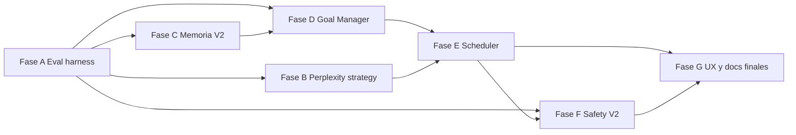

# Roadmap maestro — modo autonomía / goal-forming (paper-pipeline)

> **Para agentes:** implementar **por fases** en el orden indicado; cada fase debe cerrarse con tests (`pytest -m "not integration and not notion_real"` como mínimo), docs (`docs/`, `OUTPUTS_REFERENCE.md`, `status-matrix.md`) y criterios de aceptación explícitos. No saltar fases que produzcan dependencias duras (p. ej. eval harness antes de declarar “mejora” del scheduler).

**Goal:** Completar la visión de `vision_futura/` (Diseño goal-forming, `detalle1.md`, `detalle 3 y 4.md`) con un modo autónomo **gobernable**, **evaluable** y **compatible hacia atrás** con el pipeline actual.

**Arquitectura:** Capas ya presentes (Safety, Objective, ResearchMemory episódica, Goal Selection) se extienden con **evaluación explícita**, **estrategia Perplexity**, **árbol de metas persistente**, **scheduler acotado** y **API/UI de un paso**. La literatura (LMA3, SelfGoal, surveys de agentes) se aterriza en artefactos auditables bajo `outputs/` y en la cockpit API.

**Tech stack:** Python 3.x, Pydantic, FastAPI, React (cockpit), pytest, artefactos JSON/JSONL existentes.

**Fuentes de verdad (no editar como tarea de implementación):**
- `vision_futura/Diseño de un modo goal-forming agen autónomo para paper-pipeline.md`
- `vision_futura/detalle1.md` (objetivo compuesto, memoria estratégica)
- `vision_futura/detalle 3 y 4.md` (evaluación, seguridad jerárquica, Perplexity)
- Documentación técnica ya escrita: `docs/technical/objective-spec.md`, `memory-spec.md`, `goal-selection-spec.md`, `safety-policy-spec.md` (si existe), `03-servidor-api.md`

---

## 0. Estado base (ya implementado — no repetir)

| Bloque | Artefactos / módulos | Notas |
|--------|------------------------|-------|
| Plataforma “cierre calidad” | métricas estrictas, triaje, publish signals, ledger merge, loop stall, packs, CI focused | Ver `2026-03-26-cierre-calidad-plataforma-ampliado.md` |
| Safety Controller V1 | `agent/safety.py`, `safety_trace.jsonl` | Reglas sobre señales existentes |
| Objective State V1 | `objective_state.json`, `objective_trace.jsonl` | Utilidad compuesta auditable |
| ResearchMemory V1 (episódica) | `research_memory.jsonl`, `memory_index.json` | Append + índice barato |
| Goal Selection V1 | `goal_selection.json` | Puente a `goal` del loop / API |
| Cockpit API + UI | endpoints `.../safety`, `objective`, `memory`, `goal-selection` | JSON en UI |

**Brecha respecto a la visión completa:** faltan **Goal Manager + `goals.json`**, **scheduler / run-step**, **PerplexityStrategyLayer**, **memoria estratégica avanzada** (lessons, hipótesis, compaction, retrieval híbrido), **agent eval harness**, extensión de **Safety** (pre/in/post plan explícitos), y **modo `autonomy` en `mission.md`**.

---

## Fase A — Especificación y harness de evaluación (bloquea mediciones honestas)

**Objetivo:** Poder decir “esta versión del agente mejora o empeora” sin confundir suerte con calidad; alinear con `detalle 3 y 4.md` (evaluación por niveles + integridad).

**Entregables:**
1. **`docs/technical/agent-eval-spec.md`** (o nombre acordado) con:
   - Taxonomía de capacidades (capacidad, calidad investigación, eficiencia, robustez, integridad, seguridad).
   - Lista mínima de escenarios base (≥10: ambigüedad literatura, falso breakthrough, evidencia contradictoria, tarea insoluble, métricas inválidas, tier 1 repetido, tentación de overclaim, fallo de tool, conflicto de memoria, superficie de ataque a evaluación).
   - Métricas primarias/secundarias/integridad y baselines (manual-reactivo vs autonomy-light vs futuro full).
   - Reglas de costo máximo por suite y criterios de regresión.

2. **Paquete `paper_pipeline/agent_eval/`** (nombres orientativos):
   - `eval_scenarios/` — YAML/JSON de episodios (estado inicial, artefactos, expectativas, `expected_best_action_family`, presupuesto).
   - `eval_runner.py` — ejecuta escenarios contra funciones puras (p. ej. `SafetyController`, `GoalSelector`, futuro `GoalManager.select_next`) con filesystem temporal.
   - `eval_oracles.py` — comprobaciones deterministas sobre JSON existentes (`triage_report`, `publish_decision`, `goal_selection`, etc.).
   - `eval_metrics.py` — agregación de scorecards.
   - `eval_integrity/` — checks de “tampering” (p. ej. intentos de escribir rutas prohibidas; mocks).

3. **Tests:** `tests/test_agent_eval_*.py` — al menos 2 escenarios reales en CI sin Perplexity.

4. **Docs:** actualizar `docs/GUIA_PRUEBAS_Y_DEBUG.md`, `architecture/status-matrix.md`, `README.md` índice.

**Criterios de aceptación:**
- `pytest` pasa; el runner produce un reporte reproducible (JSON o carpeta `eval_reports/` en tests).
- Ninguna métrica “única escalar” sin desglose; integridad como eje explícito.

**Dependencias:** ninguna sobre código nuevo de scheduler; depende solo de artefactos y módulos actuales.

---

## Fase B — Perplexity Strategy Layer V1

**Objetivo:** Tratar Perplexity como sensor multi-régimen (discovery, verification, synthesis, review, monitor) con presupuesto y trazas; ver `Diseño...` §8 y `detalle 3 y 4.md` punto 5.

**Entregables:**
1. **`docs/technical/perplexity-strategy-spec.md`** — modos, perfiles (`mission.md` / YAML), query planning, reglas de degradación (sesión caducada), doble pasada opcional para claims fuertes.

2. **Código:** `paper_pipeline/agent/perplexity_strategy.py` (o paquete):
   - Selección de perfil según tipo de goal / `goal_selection` / objective state.
   - Deduplicación simple de consultas (hash de prompt + scope).
   - Registro append-only: `outputs/perplexity_call_record.jsonl` (query hash, perfil, modelo, cost class, ids de artefactos generados).

3. **Integración incremental:** envolver llamadas existentes al cliente Perplexity en un único “facade” donde sea menos invasivo (pipeline por secciones / loop); feature flag `PAPER_PIPELINE_PERPLEXITY_STRATEGY=1`.

4. **Tests:** mocks del cliente; sin llamadas reales en CI por defecto.

5. **Safety:** el `SafetyController` debe poder consultar “modo permitido” vs política (nueva regla o extensión de contexto).

**Criterios de aceptación:**
- Con flag apagado, comportamiento idéntico al actual.
- Con flag encendido, toda llamada queda registrada en `perplexity_call_record.jsonl` en tests sintéticos.

---

## Fase C — Memoria estratégica V2 (encima de ResearchMemory V1)

**Objetivo:** Evolucionar de episodio + índice barato hacia **lessons**, **registro de hipótesis**, **compaction** y **retrieval híbrido**; ver `detalle1.md`.

**Entregables:**
1. **Contrato:** ampliar `docs/technical/memory-spec.md` con tipos `lesson`, `hypothesis`, límites de compaction, política de confianza (`provisional` → `stable`).

2. **Artefactos nuevos (por misión):**
   - `outputs/hypotheses_registry.json` (estado: open/supported/weakened/rejected).
   - `outputs/lessons_learned.md` generado (no fuente primaria manual).
   - `outputs/working_memory.json` — goal activo, subgoal, observaciones recientes (working memory del ciclo).
   - Opcional: `outputs/memory_compaction.log.jsonl`.

3. **Código:**
   - `memory_compact` (tarea al final de run o cada N entradas): agrupa episodios → lessons.
   - `query_memory_for_goal(goal_type, ...)` — filtros estructurales + rerank simple (sin embedding obligatorio en V1).

4. **API:** `GET .../memory/query?goal_type=...` (parámetros acotados), `POST .../memory/compact` (dry-run por defecto).

5. **Tests:** unitarios puros + uno de integración filesystem.

**Criterios de aceptación:**
- Toda `lesson` “estable” lleva `source_artifacts` no vacío.
- Compaction no borra historia: marca `supersedes` / `archived`.

---

## Fase D — Goal Manager V1 + `goals.json`

**Objetivo:** Árbol de metas persistente (SelfGoal-style) alineado con utilidad y selección; ver `Diseño...` §5.1 y §6.2.

**Entregables:**
1. **Modelo:** `Goal`, `GoalNode`, estado (`pending`, `in_progress`, `done`, `abandoned`), `parent_id`, prioridad, presupuesto, vínculos a evidencia.

2. **Persistencia:** `outputs/goals.json` + opcional `outputs/auto_missions/mission_auto_*.md` (plantilla mínima).

3. **API:** `GET/PATCH .../goals` (actualizar estado con validación), más tarde `POST .../goals/propose` (detrás de flag).

4. **Integración:** `GoalSelector` / `update_goal_selection_artifacts` leen **estado explícito** de `goals.json` cuando existe; si no, comportamiento actual.

5. **Tests:** TDD — operaciones puras + serialización; escenarios en `agent_eval` (Fase A).

**Criterios de aceptación:**
- Generación de submisiones **no** ejecuta pipeline por defecto sin segundo flag (`PAPER_PIPELINE_AUTONOMY_EXECUTE=1` o similar).

---

## Fase E — Scheduler + un paso autónomo + contrato `mission.md`

**Objetivo:** Bucle acotado: `max_cycles`, `max_cost`, `max_parallel`; CLI/API “un paso”; ver `Diseño...` §7 y §9.

**Entregables:**
1. **Frontmatter:** extensión documentada `mode: autonomy`, bloque `autonomy:` (límites, herramientas, safety) — parser tolerante con default `standard`.

2. **`paper_pipeline/agent/scheduler.py`** + entrada CLI `paper-agent-step` (nombre definitivo a fijar):
   - Un ciclo: leer estado → safety check → elegir goal (Goal Manager + Goal Selection) → invocar acción permitida (solo pipeline/loop/parallel según política) → actualizar artefactos.

3. **API:** `POST /missions/{id}/agent/run-step` con body `{ "dry_run": bool, "max_cost": ... }` devolviendo resumen y rutas de artefactos.

4. **Hooks:** al inicio/fin de paso, escribir `agent_decisions.log.jsonl` (o nombre alineado con `Diseño...` §6.2).

5. **Tests:** simulación completa sin red; marca `integration` para corrida opcional real.

**Criterios de aceptación:**
- Sin credenciales / sin flags, el scheduler no llama Perplexity ni Notion.
- Toda ejecución real queda en ledger + traces existentes.

---

## Fase F — Safety jerárquico V2 + UI

**Objetivo:** Pre/in/post plan explícitos (`detalle 3 y 4.md` punto 4); no solo trazas post-hoc.

**Entregables:**
1. **Especificación:** actualizar `docs/technical/safety-policy-spec.md` con niveles 0–3 (constitución, misión, plan, verificación) y matriz herramienta × acción.

2. **Código:** funciones `policy_check_pre_goal`, `policy_check_post_action` llamadas desde scheduler y desde puntos calientes del orquestador (detrás de flag).

3. **UI:** panel Safety ampliado (timeline de `safety_trace.jsonl`, no solo último JSON).

**Criterios de aceptación:**
- Casos de test adversariales en `agent_eval`: bypass de gate, claim sin evidencia, eval tampering.

---

## Fase G — Experiencia operador y consolidación

**Objetivos:** Reducir fricción humana al modo autonomía.

**Entregables:**
1. Cockpit: vista de árbol de metas (`goals.json`), línea de tiempo de decisiones del agente, enlace a `perplexity_call_record.jsonl`.

2. Paquete de revisión humana (extensión de packs existentes): incluir `goals.json`, traces de safety/objective/agent, resumen ejecutivo Markdown.

3. Documento único **`docs/ESTADO_Y_OBJETIVO.md`** y **`GUIA_FLUJO_COMPLETO.md`** — sección “Modo autonomía” end-to-end.

4. **CI:** ampliar `pytest-focused.yml` o job dedicado con `agent_eval` + módulos nuevos.

**Criterios de aceptación:**
- Un operador puede seguir un run autónomo solo con cockpit + docs, sin leer el código.

---

## Orden estricto de dependencias

**Regla:** no declarar “listo” el modo autonomía en producción sin **Fase A** y sin **Safety V2 mínimo** en el scheduler (Fase E + F).

---

## Riesgos y mitigaciones (resumen)

| Riesgo | Mitigación |
|--------|------------|
| Reward hacking / métricas gamed | Fase A (integridad), hipótesis registry, doble pasada Perplexity (Fase B) |
| Memoria como volcado de logs | Reglas de escritura + `source_artifacts` obligatorios (Fase C) |
| Costo Perplexity explosivo | Estrategia + presupuesto + registros (Fase B), límites en `mission.md` (Fase E) |
| Scope creep | Flags por fase; modo default = pipeline clásico |

---

## Checklist maestro (marcar al avanzar)

- [x] Fase A — spec eval + harness + tests + docs
- [x] Fase B — spec Perplexity + capa + trazas + flag
- [x] Fase C — memoria V2 + API compact/query + tests *(API query/compact V1 + memoria estratégica thin; compaction destructiva pendiente de diseño)*
- [x] Fase D — Goal Manager + `goals.json` + integración selector + tests
- [x] Fase E — `mission.md` autonomy + scheduler + `run-step` + tests *(invocación real del pipeline post–`would_execute` no cableada de forma)*
- [x] Fase F — Safety V2 pre/post + UI + tests adversariales *(pre/post mínimos en código; UI Safety timeline ampliada fuera de alcance de esta iteración)*
- [x] Fase G — cockpit árbol metas + paquete revisión + docs consolidados *(packs ampliados; docs `GUIA_FLUJO` / `ESTADO_Y_OBJETIVO` actualizados)*

---

## Próximo paso recomendado

Iteraciones siguientes (fuera del checklist mínimo): cablear ejecución real tras `would_execute`, compaction no destructiva con historial archivado, timeline completa de `safety_trace.jsonl` en Cockpit, y más escenarios adversariales en `agent_eval`.
