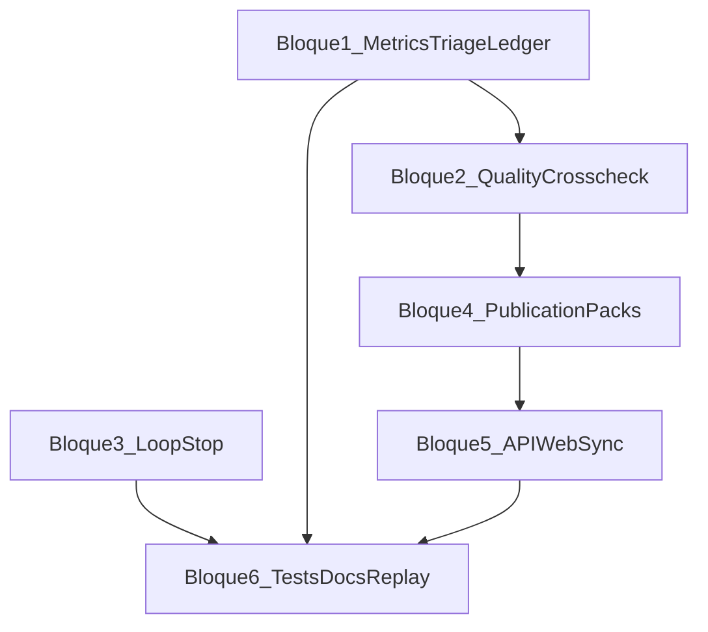

# Plan ampliado — Cierre calidad, evidencia, loop y publicación (paper-pipeline)

> Plan de trabajo **detallado** para continuar después del estado actual (ledger, preflight, quality gates, evidence index, cockpit API, etc.). Objetivo: acercar el repo a la visión de [`vision_futura/tareas`](../../vision_futura/tareas) sin dispersarse en features sueltas.

**Principio:** cada entregable produce artefactos en disco, tests y un párrafo de doc; nada queda “implícito”.

### Estado de implementación (revisión 2026-03-26)

| Bloque | Estado |
|--------|--------|
| §3 Métricas estrictas + triage | Hecho: `metrics_io.py`, `triage.py`, `metrics_validation_errors`, tests, doc HIPERVISOR, `examples/metrics.valid.json` |
| §4 Señales publish + ledger | Hecho: `signals.py`, `publish_manager`, `merge_ledger_after_triage`, matriz en `02-orquestador.md` |
| §5 Loop + `stop_decision` | Hecho: `integrated_loop_main` + `loop_state.json`; criterio §5.3: `run.log` con `step_error` + `error=loop_stop` + `loop_stop=true` |
| §6 Packs | Hecho: `packs.py`, flag `PAPER_PIPELINE_BUILD_PACKS`, guía en `GUIA_FLUJO_COMPLETO.md` §5.1 |
| §7 API / cockpit | Hecho: endpoints publish/loop/metrics, `CockpitPage` con secciones colapsables |
| §8 Tests / replay / CI | Hecho: `test_replay_ledger_from_log.py`, docs PRUEBAS + status-matrix; job opcional `.github/workflows/pytest-focused.yml` |

**Nota:** el “hook” post-draft del §5.1 vive en el CLI `paper-loop` tras cada `run_integrated_cycle` (véase docstring de `integrated_loop.py`). Modo relax **`PAPER_PIPELINE_RELAX_METRICS`** (§11): implementado en `hypervisor/triage.py` + doc en `HIPERVISOR_Y_PARALELO.md` y `.env.example`.

---

## 1. Contexto y alcance

### 1.1 Ya existe (no repetir trabajo)

- `mission_version`, `validate_mission_contract`, `schemas/mission.schema.json`
- `outputs/run_ledger.json`, `LedgerWriter`, fases en [`runner.py`](../../paper_pipeline/pipeline/runner.py)
- `preflight_report.json`, [`preflight.py`](../../paper_pipeline/pipeline/preflight.py)
- `validation/quality_validation.json`, `evidence/claims.json`, `evidence/evidence_index.json`
- `publication/publish_decision.json` (mínimo)
- API cockpit: ledger, evidence, claims, triage, publish preview, specs generate
- Paralelo: `batch_summary.json`, `leaderboard.json`
- [`MetricsBundle`](../../paper_pipeline/evidence/metrics_model.py) + `schemas/metrics.schema.json`
- [`loop_stall_detector`](../../paper_pipeline/validation/loop_stall_detector.py) (heurística básica)

### 1.2 Fuera de alcance de esta fase (para no inflar el plan)

- Reescritura total del frontend (React completo tipo “Mission Editor v2” con todos los tabs).
- Integración Notion con bases de datos formales (API de bases) — solo payload editorial incremental.
- Infra de proveedores (circuit breaker, colas) salvo un **adapter mínimo** documentado como stub.
- Stress 20–50 worktrees en CI (solo script/manual documentado).

### 1.3 Definición de “done” global (esta fase)

1. **Métricas** validadas antes de triage; tier 3 imposible con métricas inválidas o sin `schema_version` acordado.
2. **Triage** y **publish_decision** leen la misma lógica de bloqueos (quality + métricas), sin contradicciones.
3. **Loop** (`paper-loop`) puede escribir `outputs/loop/stop_decision.json` y terminar con código documentado ante degradación.
4. **Packs** `research_pack/` y manifiesto `code_pack` generados solo si publicación elegible.
5. **Tests** nuevos cubren contrato de métricas, triage, loop y packs; **docs** actualizadas (PRUEBAS, status-matrix, hipervisor).

---

## 2. Mapa de dependencias (orden sugerido)

Los bloques 1–2 pueden solaparse en PRs pequeños; 3 es paralelizable si no toca los mismos archivos que 1–2 en el mismo commit conflictivo.

---

## 3. Bloque 1 — Contrato de métricas estricto en triage

**Meta:** `outputs/metrics.json` debe pasar validación Pydantic (`MetricsBundle`) antes de calcular tiers.

### 3.1 Tareas técnicas

1. Añadir función `load_and_validate_metrics(path: Path) -> tuple[MetricsBundle | None, list[str]]` en [`paper_pipeline/evidence/metrics_model.py`](../../paper_pipeline/evidence/metrics_model.py) o nuevo `metrics_io.py`.
2. En [`hypervisor/triage.py`](../../paper_pipeline/hypervisor/triage.py), en el punto de lectura de métricas:
   - Si el archivo no existe: mantener comportamiento actual (sin triage o log informativo).
   - Si existe: validar; si falla: **tier 0** (o `tier=None` + `reason=invalid_metrics`) y escribir en `triage_report.json` campo `metrics_validation_errors: [...]`.
3. Si `schema_version` falta en JSON legacy: inferir `schema_version=1` solo si se documenta como compatibilidad; si no, fallar validación con mensaje claro.
4. Actualizar [`docs/HIPERVISOR_Y_PARALELO.md`](../../docs/HIPERVISOR_Y_PARALELO.md): sección “Métricas inválidas”.

### 3.2 Tests

- `tests/test_triage_metrics_validation.py`: fixture JSON válido, inválido (coverage >1), inválido (campo tipo incorrecto), legacy sin `schema_version` (decidir expectativa y fijarla en el test).

### 3.3 Criterio de aceptación

- Ningún `triage_report.json` con tier 3 si `MetricsBundle` no valida.
- `pytest` verde sin `integration`.

---

## 4. Bloque 2 — Cruce quality gates + triage + ledger + publish

**Meta:** una sola fuente de “¿se puede promocionar?” derivada de artefactos.

### 4.1 Tareas técnicas

1. Definir función pura `compute_publish_signals(output_dir: Path, mission: Mission) -> dict` en nuevo `paper_pipeline/publication/signals.py` (o extender [`publish_manager.py`](../../paper_pipeline/publication/publish_manager.py)):
   - Lee `quality_validation.json` (`publishable`, `blocking_reasons`).
   - Lee `triage/triage_report.json` si existe (`tier`, `label`).
   - No hace llamadas de red.
2. `write_publish_decision` debe usar `compute_publish_signals` y **no** duplicar lógica suelta.
3. Opcional pero recomendado: si `tier == 3` y `quality_validation.publishable == false`, `eligible_for_publication` debe ser **false** con razón explícita `tier3_without_quality_gates`.
4. Post-triage (o post-`run_pipeline_v2` / worktree): si existe `run_ledger.json`, actualizar `decision.triage_tier`, `decision.publishable`, `decision.blocking_reasons` (helper `merge_ledger_after_triage` en [`ledger/writer.py`](../../paper_pipeline/ledger/writer.py) o script idempotente).

### 4.2 Tests

- Tabla de casos: (tier, quality publishable) → eligible esperado.
- Test de ledger merge opcional con `tmp_path`.

### 4.3 Criterio de aceptación

- `publish_decision.json` siempre explicable con lista de razones.
- Documentar matriz en [`docs/technical/02-orquestador.md`](../../docs/technical/02-orquestador.md) o nueva subsección en `docs/architecture/`.

---

## 5. Bloque 3 — Loop seguro: estado, comparación y `stop_decision.json`

**Meta:** `paper-loop` no deja correr ciclos vacíos sin dejar rastro.

### 5.1 Tareas técnicas

1. Crear `outputs/loop/loop_state.json` (o reutilizar `run_state` con prefijo `loop_`) con:
   - `last_draft_sha256` o `last_draft_chars`
   - `consecutive_stalls` o `consecutive_noop_cycles`
2. Tras cada rebuild de `draft_paper.md` en el flujo de [`integrated_loop.py`](../../paper_pipeline/integrated_loop.py) (y/o punto único al final de ciclo):
   - Leer draft anterior (desde estado o snapshot).
   - Llamar [`is_stalled`](../../paper_pipeline/validation/loop_stall_detector.py) y/o comparación de longitud.
3. Si política dispara: escribir `outputs/loop/stop_decision.json` con `status`, `reasons`, `cycle`, `timestamp`.
4. Salida de proceso: alinear con `ExitCode` existente (`LOOP_STALLED` u otro) — buscar en [`constants.py`](../../paper_pipeline/constants.py).
5. Variables de entorno: `LOOP_STALL_MAX_CONSECUTIVE=2`, `LOOP_MIN_DELTA_CHARS=20` (documentar en `.env.example`).

### 5.2 Tests

- `tests/test_integrated_loop_stop.py`: sin red, mocks de paths; draft idéntico → stop tras N ciclos.

### 5.3 Criterio de aceptación

- Archivo `stop_decision.json` presente cuando corresponde; log JSONL con evento `loop_stop`.

---

## 6. Bloque 4 — Packs de publicación (research + code)

**Meta:** carpeta lista para zip/zipfile para revisión externa.

### 6.1 Tareas técnicas

1. Nuevo módulo `paper_pipeline/publication/packs.py`:
   - `build_research_pack(output_dir: Path) -> Path` — copia selectiva (shutil o symlinks en Unix; documentar Windows).
   - `build_code_pack_manifest(output_dir: Path, repo_root: Path | None) -> Path` — `MANIFEST.md` con `git rev-parse HEAD` opcional.
2. Invocar desde `write_publish_decision` **solo** si `eligible_for_publication` (o flag `PAPER_PIPELINE_BUILD_PACKS=1`).
3. Estructura mínima research:
   - `draft_paper.md`, `evidence/claims.json`, `validation/quality_validation.json`, `triage/triage_report.json` (si existe), `evidence/evidence_index.json`, `publication/publish_decision.json`.

### 6.2 Tests

- `tests/test_publication_packs.py`: elegible → carpetas existen; no elegible → no se crean `research_pack/` o quedan vacías según política.

### 6.3 Criterio de aceptación

- Un comando documentado: “cómo zippear el pack” en [`docs/GUIA_FLUJO_COMPLETO.md`](../../docs/GUIA_FLUJO_COMPLETO.md) (2–3 líneas).

---

## 7. Bloque 5 — API / web: coherencia con nuevos artefactos

**Meta:** cockpit muestra estado real sin 404 silenciosos.

### 7.1 Tareas técnicas

1. Añadir endpoints (o extender existentes en [`missions_cockpit.py`](../../paper_pipeline/server/routers/missions_cockpit.py)):
   - `GET /api/missions/{id}/publish/decision` (alias de lectura de `publish_decision.json`)
   - `GET /api/missions/{id}/loop/stop` (si existe `stop_decision.json`)
2. [`CockpitPage.tsx`](../../web/src/pages/CockpitPage.tsx): secciones colapsables para publish + loop + triage (aunque sea JSON crudo).
3. Opcional: `GET /api/missions/{id}/metrics/validated` — devuelve `ok` + errores de validación.

### 7.2 Tests

- `test_server.py`: 404 vs 200 para `stop_decision` ausente/presente.

### 7.3 Criterio de aceptación

- Navegación manual: misión con run completo muestra al menos ledger + publish.

---

## 8. Bloque 6 — Pirámide de pruebas, replay, documentación

**Meta:** regresiones visibles.

### 8.1 Tareas técnicas

1. **Replay ligero:** `tests/test_replay_ledger_from_log.py` — opcional; construir mini `run.log` JSONL y verificar que `phases` del ledger pueden reconstruirse (aunque sea parcial).
2. Actualizar [`docs/PRUEBAS_NIVELES_5_10_NOTION.md`](../../docs/PRUEBAS_NIVELES_5_10_NOTION.md): nivel N para “métricas + triage + publish” en un solo párrafo.
3. Actualizar [`docs/architecture/status-matrix.md`](../../docs/architecture/status-matrix.md) con filas de bloques 1–6.
4. **CI:** si existe workflow, añadir job opcional `pytest tests/test_triage_* tests/test_publication_*` sin cambiar el marcador global. **Implementado:** [`.github/workflows/pytest-focused.yml`](../../../.github/workflows/pytest-focused.yml) (ajustar rutas si el repo git está en un monorepo padre).

### 8.2 Criterio de aceptación

- Nuevo colaborador puede seguir solo la doc para validar un run end-to-end.

---

## 9. Lista maestra de tareas (checklist operativa)

Usar esta lista como issues/PRs en orden; cada ítem es un PR pequeño.

### Fase A — Métricas y triage

- [x] A1: `load_and_validate_metrics` + tests unitarios
- [x] A2: Integrar validación en `triage.py` + campo `metrics_validation_errors`
- [x] A3: Doc hipervisor + ejemplo `metrics.json` válido en `scripts/examples/` o `docs/`

### Fase B — Señales de publicación

- [x] B1: `compute_publish_signals` + refactor `publish_manager`
- [x] B2: Matriz tier × quality + tests parametrizados
- [x] B3: Merge ledger post-triage (helper + test)

### Fase C — Loop

- [x] C1: `loop_state.json` persistencia
- [x] C2: Hook post-draft en `integrated_loop` + `stop_decision.json` *(CLI `paper-loop` / `integrated_loop_main`; ver docstring en `integrated_loop.py`)*
- [x] C3: Exit code + env vars + `.env.example`
- [x] C4: Tests integrados loop sin red

### Fase D — Packs

- [x] D1: `packs.py` research_pack
- [x] D2: code_pack MANIFEST
- [x] D3: Tests de elegibilidad
- [x] D4: Guía usuario 3 líneas

### Fase E — API/Web

- [x] E1: Endpoints publish/loop/metrics
- [x] E2: Cockpit UI mínima ampliada
- [x] E3: Tests server

### Fase F — Cierre doc/tests

- [x] F1: status-matrix + PRUEBAS
- [x] F2: replay test opcional
- [x] F3: Pasada completa `pytest -m "not integration and not notion_real"`

---

## 10. Estimación orientativa (no compromiso)

| Fase | Esfuerzo relativo |
|------|-------------------|
| A | M |
| B | M |
| C | L (mucho cuidado con edge cases) |
| D | S–M |
| E | S–M |
| F | S |

**Total:** varias sesiones de trabajo; conviene PRs por bloque, no un mega-PR.

---

## 11. Riesgos y mitigaciones

| Riesgo | Mitigación |
|--------|------------|
| Triage más estricto rompe proyectos viejos | `schema_version` + modo legacy documentado o flag `PAPER_PIPELINE_RELAX_METRICS=1` temporal |
| Falsos positivos en loop stall | Umbrales por env + telemetría en `run.log` |
| Duplicación ledger vs manifest | Un solo helper para “decisión final” |

---

*Este documento sustituye al plan resumido anterior como referencia detallada para implementación en el repo.*
