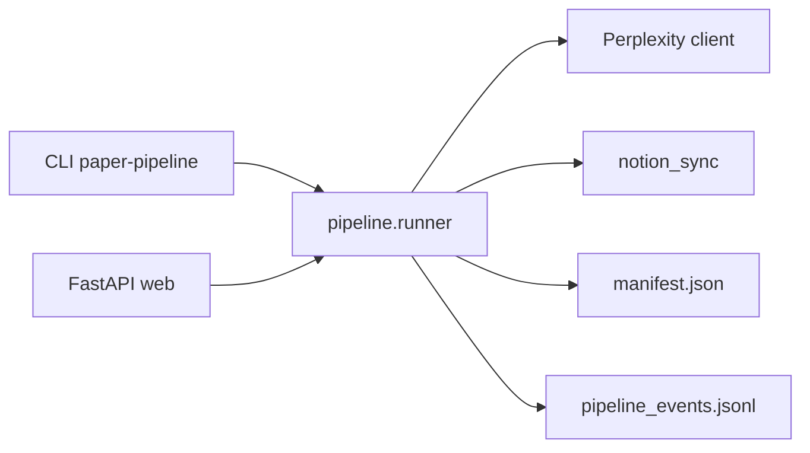

# 01 — Arquitectura

## Vista general

Fuente canónica del diagrama (export LaTeX / PNG): [`docs/assets/architecture_overview.mmd`](../assets/architecture_overview.mmd). Ver [`docs/assets/README.md`](../assets/README.md).

## Paquetes

| Paquete / carpeta | Rol |
|-------------------|-----|
| `paper_pipeline/pipeline/` | Fases: Perplexity, assembly, experiment_runner (opcional), quality, Notion, cursor CLI; bucle experimento post-Cursor opcional (`experiment_iteration.py`) |
| `paper_pipeline/server/` | REST + SSE; `missions_*` routers |
| `paper_pipeline/parallel/` | Git worktrees, `agent_executor`, `command_safety` |
| `paper_pipeline/epistemic/` | DCA: `queries`, `persistence`, `injector` |
| `paper_pipeline/debug/` | Triaje matemático: `error_classifier`, `debug_prompts` |

## Dependencias

- `mission.md` → `Mission` (Pydantic) → orquestador.
- `outputs/run_state.json` → reanudación de pasos.
- `outputs/manifest.json` → fases del último run (UI / auditoría).
